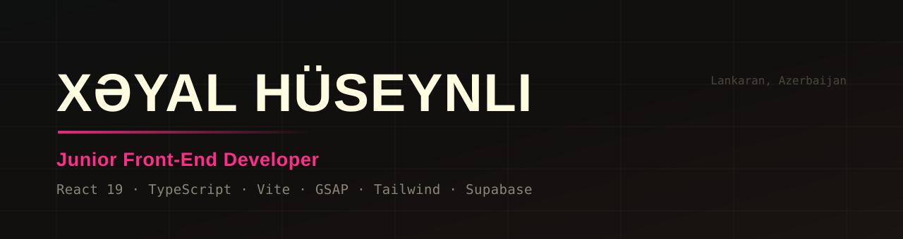
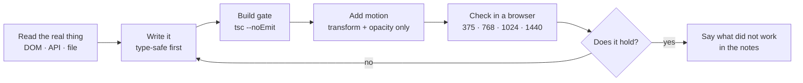

  

I build interfaces with React and TypeScript, and I care about the parts that are easy to skip:
scroll behaviour, type safety, and interfaces that still work when the network is slow.

I study Information Technology at Lankaran State University (2025–2029) and I build in my own time.
Every project here is written from scratch — no templates, no page builders.

---

### Tech I work with

---

### How I work

The loop is the part I would want a reviewer to judge me on — not the finished screenshot.

---

### Selected work

<table>
<tr>
<td width="50%" valign="top">

**[Hypnos.dev](https://github.com/Mister2314/Hypnos.dev)**

Personal site built as an 11-scene scroll story — scroll-scrubbed WebP frame sequences rendered on
canvas, GSAP timelines and Lenis smooth scroll. No 3D library.

[**Live →**](https://hypnosdev.vercel.app)

</td>
<td width="50%" valign="top">

**[Pawsoome](https://github.com/Mister2314/Final_Project_2)**

Pet-shop e-commerce app: nested catalogue, cart, wishlist, checkout, authentication and an admin
dashboard. Redux Toolkit + Supabase.

[**Live →**](https://pawsoome.netlify.app/)

</td>
</tr>
<tr>
<td width="50%" valign="top">

**[Khayal Verse](https://github.com/Mister2314/Portfolio-2)**

One-page cinematic portfolio with a hand-written scroll engine — video scrubbing, spring physics
and a comic-ink design system.

[**Live →**](https://portfolio-2-inky-ten.vercel.app)

</td>
<td width="50%" valign="top">

**[Nested Comments Thread](https://github.com/Mister2314/Nested-Comments-Thread)**

Recursive comment UI with unlimited reply depth, inline editing and a custom hook that persists the
whole tree.

[**Live →**](https://nested-comment-systemm.netlify.app/)

</td>
</tr>
</table>

[**All repositories →**](https://github.com/Mister2314?tab=repositories)

---

<b>How I build — the working method</b>

Every project here follows the same loop, and the loop is the part I would want a reviewer to judge
me on.

**1. Read the real thing before writing code.** Not the docs — the actual DOM, the actual API
response, the actual file. A guessed selector or an assumed field name fails *silently*, and a
silent failure costs more time than a loud one.

**2. Make it type-safe, then make it move.** `tsc --noEmit` runs as a blocking gate in the build,
so a type error cannot reach production. Motion comes after, and it animates `transform` and
`opacity` only — those stay on the compositor. Animating `width` or `top` forces layout on every
frame.

**3. Keep scroll native.** `scroll-behavior: smooth` hijacks the scrollbar and breaks
`position: sticky`. Lenis interpolates the offset instead, so the scrollbar still works and sticky
still works.

**4. Assert the property, not the exit code.** "It ran" is not "it worked". A script that reports
success on a zero-byte file is worse than one that crashes — it manufactures false confidence. So
the checks assert what actually matters: the duration, the file size, the effect visible in a
sampled frame.

**5. Verify in a browser, at real sizes.** 375 / 768 / 1024 / 1440. A layout that only looks right
at 1440 is not a layout.

**6. Say what did not work.** If a tool degraded, if an approach failed, if a result is unverified —
that goes in the notes rather than being absorbed into a confident-looking answer.

<b>What I am looking for</b>

A **front-end internship or junior role** — remote, or in Azerbaijan. I am at my best where there is
a real codebase to learn from and someone who will review my pull requests.

I study Information Technology at Lankaran State University (2025–2029) and I build in my own time.
Every project in this profile is written from scratch — no templates, no page builders.

**What I bring:** React and TypeScript that compiles strictly, motion that respects
`prefers-reduced-motion`, and a habit of checking the output instead of assuming it.

**What I am working on:** deepening my English (currently pre-intermediate — vocabulary is fine,
grammar is the gap) and moving from "it works on my machine" to "it is tested".

<b>Currently learning</b>

- **Testing** — moving from manual checks to a real suite. `test-driven-development` for anything
  non-trivial.
- **Performance** — reading real traces instead of guessing where the time goes.
- **English** — the ceiling on every remote opportunity, and I know it.
- **Backend** — enough Supabase and Postgres to stop treating the server as a black box.

---

### Get in touch

Open to front-end internships and junior roles — remote or in Azerbaijan.

