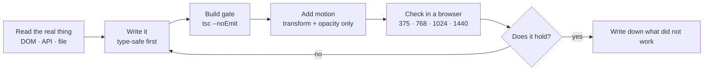

<p align="center">
  
</p>

<p align="center">
I build interfaces with React and TypeScript, and I care about the parts that are easy to skip:
scroll behaviour, type safety, and interfaces that still work when the network is slow.
</p>

<p align="center">
IT student at Lankaran State University (2025–2029). Every project here is written from
scratch — no templates, no page builders.
</p>

---

### Stack

```
TypeScript · React 19 · GSAP · Lenis · Vite
Vanilla JS · CSS · Framer Motion · Supabase · Redux Toolkit
```

**Now** *(late 2026)* — rebuilding [hypnosdev.vercel.app](https://hypnosdev.vercel.app) as an
11-scene scroll story: WebP frame sequences scrubbed on canvas, GSAP timelines, Lenis, and a
preloader that only says "done" when every frame is actually loaded.

---

### Selected work

<table>
<tr>
<td width="50%" valign="top">

**[Hypnos.dev](https://github.com/Mister2314/Hypnos.dev)**

Personal site as an 11-scene scroll story — scroll-scrubbed WebP frame sequences rendered on
canvas, GSAP timelines and Lenis. No 3D library, no video file: every frame is earned by scroll.

[**Live →**](https://hypnosdev.vercel.app)

</td>
<td width="50%" valign="top">

**[Pawsoome](https://github.com/Mister2314/Final_Project_2)**

Pet-shop e-commerce: nested catalogue, cart, wishlist, checkout, auth and an admin dashboard.
Redux Toolkit + Supabase.

[**Live →**](https://pawsoome.netlify.app/)

</td>
</tr>
<tr>
<td width="50%" valign="top">

**[Khayal Verse](https://github.com/Mister2314/Portfolio-2)**

One-page cinematic portfolio with a hand-written scroll engine — video scrubbing, spring physics
and a comic-ink design system.

[**Live →**](https://portfolio-2-inky-ten.vercel.app)

</td>
<td width="50%" valign="top">

**[Nested Comments Thread](https://github.com/Mister2314/Nested-Comments-Thread)**

Recursive comment UI with unlimited reply depth, inline editing and a custom hook that persists
the whole tree to `localStorage`.

[**Live →**](https://nested-comment-systemm.netlify.app/)

</td>
</tr>
</table>

[**All repositories →**](https://github.com/Mister2314?tab=repositories)

---

<details>
<summary><b>How I work</b></summary>



The loop is the part I would want a reviewer to judge me on — not the finished screenshot.
Two habits behind it: `tsc --noEmit` runs as a blocking gate, so a type error cannot reach
production; and motion animates `transform` and `opacity` only, because animating `width` or
`top` forces layout on every frame. I verify in a real browser at real sizes — a layout that
only looks right at 1440 is not a layout.

</details>

<details>
<summary><b>What I am looking for</b></summary>

A **front-end internship or junior role** — remote, or in Azerbaijan. I am at my best where
there is a real codebase to learn from and someone who will review my pull requests.

Honest about the gaps: my English is pre-intermediate (vocabulary fine, grammar is the gap —
I work on it daily), and I am moving from "it works on my machine" to "it is tested".

What I bring instead: React and TypeScript that compiles strictly, motion that respects
`prefers-reduced-motion`, and a habit of checking the output instead of assuming it.

</details>

---

### Get in touch

<p align="center">
<a href="https://hypnosdev.vercel.app"></a>
<a href="https://www.linkedin.com/in/x%C9%99yal-h%C3%BCseynli-3487b91ba/"></a>
<a href="mailto:xeyalhuseynli06@gmail.com"></a>
</p>
